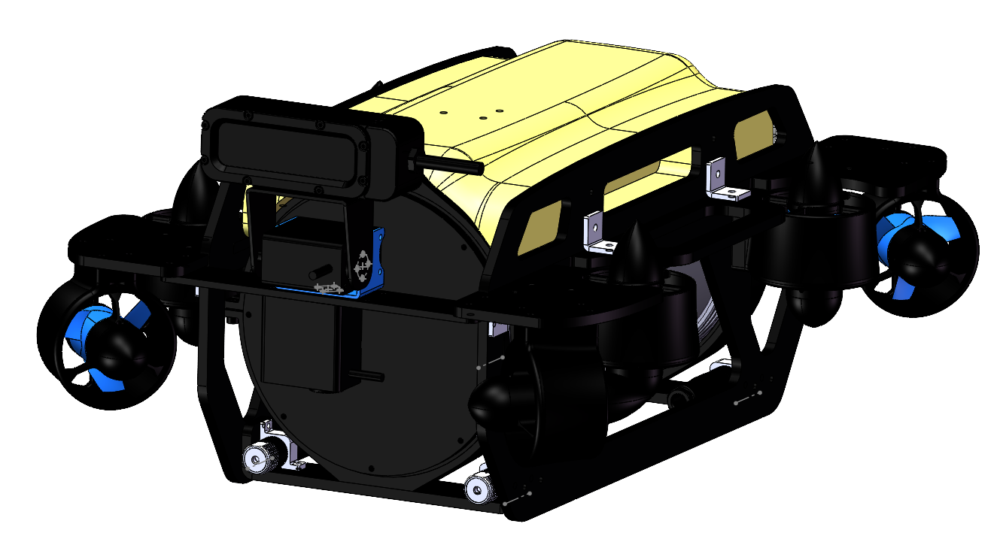

# IWIN-FINS V4 / V4-pro

[中文 / Bilingual home](README.md) · **English** · [Download BOM](hardware/bom/V4-V4pro-BOM.xlsx)

V4 and V4-pro are two hardware and software configurations in the IWIN-FINS underwater robot project. This repository brings together mechanical designs, bills of materials, wiring, controller firmware, topside software, and build and deployment documentation for reproduction, maintenance, and further development.

**This repository remains private.** Components retain their original licenses. Available material, missing programs, and outstanding validation are documented separately.



## Overview

Both vehicles use eight thrusters, with different controllers, onboard computers, motor drivers, and control protocols. The two Pro firmware branches are also documented separately.

| Item | V4 | V4-pro |
| --- | --- | --- |
| Controller described in source documents | RoboMaster Type C board | RoboMaster Type A board |
| Onboard computer | Raspberry Pi 4B | Jetson Orin Nano / NX; verify carrier board |
| Firmware | IWIN-FINS `V4-ly`, default V40 | FineSUB `v4pro1` plus `V4pro2` variant patch |
| Thruster drive | I²C → PCA9685 → 8 PWM channels | DSHOT → two 4-in-1 ESCs → 8 motors |
| Control link | PC TCP 5000 → Raspberry Pi → UART6 | PC UDP 12345 → Jetson → UART3 |
| Command UART | 115200, 8E1 | 115200, 8N1 |
| Mechanical sources | Full model dated 2025-05-23; camera mount dated 2025-07-10 | `V4pro.zip` from the Pro build document |

Firmware is not interchangeable by changing a version flag. Thruster wiring, UART frames, sensor axes, power rails, and control gains must match the actual vehicle. Read the [variant comparison](docs/variants.en.md) and [architecture](docs/architecture.en.md). Rated depth, endurance, and speed are not specified because the supplied material lacks a complete, verifiable test record for these builds.

## Bill of materials

**[Download the bilingual Excel BOM](hardware/bom/V4-V4pro-BOM.xlsx).** Separate V4 and V4-pro sheets include Chinese and English names, quantities, units, specifications, supplier links, sources, and unresolved items.

[BOM release downloads](https://github.com/FPJ-GAOGE/V4-Underwater-Robot/releases/tag/bilingual-bom-2026-10-22) · [SHA-256 checksums](hardware/bom/SHA256SUMS.txt)

| Variant | Online guide | CSV |
| --- | --- | --- |
| V4 | [BOM guide](docs/bom.en.md) | [V4-BOM.csv](hardware/bom/V4-BOM.csv) |
| V4-pro | [BOM guide](docs/bom.en.md) | [V4-pro-BOM.csv](hardware/bom/V4-pro-BOM.csv) |

The [bilingual JSON dataset](hardware/bom/bom-data.json) records the underlying data. Unspecified quantities remain blank with notes. Historical conflicts in servo count, relay current rating, and Pro servo voltage are retained. Supplier records help identify specifications; current prices and availability have not been verified. Machining, printed parts, and wiring are included, with final quantities to be checked against the matching CAD and assembly.

## Structure and assembly

STEP / DWG and other manufacturing or exchange files are stored in Git. Complete SolidWorks source archives, including native assemblies, are available in the [mechanical source release](https://github.com/FPJ-GAOGE/V4-Underwater-Robot/releases/tag/mechanical-source-2026-10-22). Access requires a GitHub account with permission to this repository.

- [Mechanical file index](hardware/README.en.md)
- [V4 hardware and wiring](docs/hardware-v4.en.md)
- [V4-pro hardware and wiring](docs/hardware-v4-pro.en.md)

## Controllers

V4 uses the specified IWIN-FINS `V4-ly` branch. V4-pro uses a pinned FineSUB `v4pro1` snapshot with a patch for `V4pro2`. Import records identify commits, dependencies, build entry points, and limitations.

| Source | Guides |
| --- | --- |
| [V4 firmware](firmware/v4) | [Import record](firmware/v4/IMPORT.en.md) · [Protocol and build](docs/firmware-v4.en.md) |
| [V4-pro firmware](firmware/v4-pro) | [Import record](firmware/v4-pro/IMPORT.en.md) · [Pro1 / Pro2](firmware/v4-pro/variants/README.en.md) |

## Topside software and deployment

The V4 PC gamepad client is in `software/v4-topside`. Pro Jetson serial forwarding, video scripts, and deployment templates are in `software/v4-pro-jetson`. Select the vehicle configuration before configuring networking and UART. The V4 TCP client is incompatible with the Pro UDP protocol.

- [Operation and deployment](docs/operation.en.md)
- [V4 PC client](software/v4-topside/IMPORT.en.md)
- [V4-pro Jetson](software/v4-pro-jetson/README.en.md)

## Repository layout

```text
firmware/v4/                  IWIN-FINS V4-ly controller source
firmware/v4-pro/              FineSUB pro1, pinned dependencies, pro2 patch
software/v4-topside/          V4 PC gamepad and plotting clients
software/v4-pro-jetson/       Pro Jetson control, video, deployment templates
software/legacy-2025-communication/  Historical image-transfer examples
hardware/bom/                Bilingual Excel, CSV and source data
hardware/v4/                 V4 CAD, manipulator, camera mount, wiring PDF
hardware/v4-pro/              V4-pro CAD and thrust calculation script
docs/                        Chinese and English technical guides
tools/                       Offline integrity checks
```

## Validation and remaining gaps

Source, CAD, and attachment integrity, Python syntax, and offline protocol encoding have been checked. Cross-compilation and hardware integration have not been completed. The supplied sources omit the current V4 Raspberry Pi `joystick_control` server and confirmed source code for the matching Pro Windows gamepad application.

See [validation records](docs/validation.en.md) and [known limitations](docs/known-limitations.en.md).

## Sources, reference, and contributions

Project material comes from the IWIN-FINS team's Feishu documents and their referenced upstream repositories. [FinsROV: An Underwater Camera-Based Multi-Robot Platform](https://github.com/IWIN-FINS/FinsROV-An-Underwater-Camera-Based-Multi-Robot-Platform) informs the bilingual presentation and organization of structure files, BOM, and build instructions. Its performance specifications and licenses do not automatically apply to this repository.

- [Source records](docs/sources.en.md)
- [Licenses and attribution](THIRD_PARTY_NOTICES.en.md)
- [Contributing](CONTRIBUTING.en.md)

The authored project documentation is available in Chinese and English. Upstream source comments, original attachments, CAD filenames, and text embedded in original figures remain unchanged.
