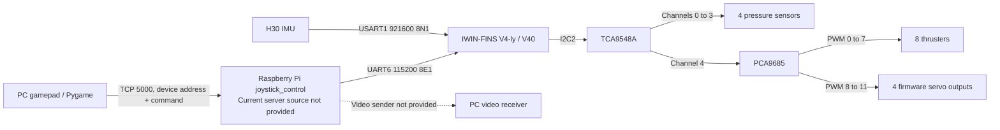
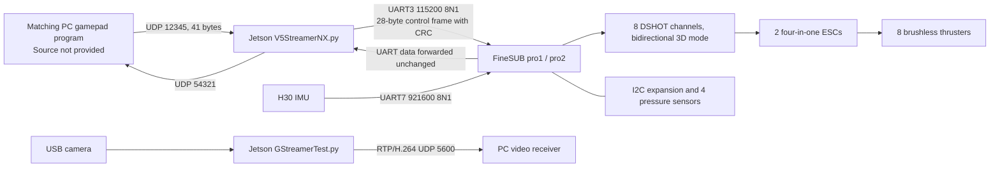

# System architecture

[中文](architecture.md) | English

These diagrams are based on the reviewed system documentation and pinned source code. Arrows indicate data/control direction; they do not replace electrical schematics.

## V4: Raspberry Pi + C board

The PC byte protocol corresponds to the firmware command table. However, TCP is a byte stream, while the firmware dispatches commands through UART idle interrupts; the missing Raspberry Pi server's treatment of boundaries and timing cannot yet be verified. Four servo channels are a source-code capability, not evidence that a particular vehicle has four installed servos. The procurement list and older wiring guide disagree on quantity.

## V4-pro: Jetson + A board

Static inspection shows that the Jetson script and FineSUB use matching 28-byte control-frame formats; this is not proof of a working hardware link. FineSUB uses DSHOT for thrusters and separate PWM outputs for servos and lights. A board port being labeled PWM does not mean that the ESC protocol is ordinary pulse-width control. See the [Jetson guide](../software/v4-pro-jetson/README.en.md) for the complete protocol, native-byte-order dependency, and deployment parameters.

## Where to change configuration

| Change | V4 | V4-pro |
| --- | --- | --- |
| Thruster order, directions, initial values, controllers | `firmware/v4/userCode/devices/Src/Propeller.cpp` and its corresponding `.h` | `firmware/v4-pro/Interface/Examples/TaskSUB.cpp`; also see the pro2 patch |
| Pressure offsets, sensor locations, depth processing | `Sensor.cpp` / `Sensor.h` | `TaskSUB.cpp` and the MS5837 drivers |
| IMU mounting orientation | H30 mapping in `IMU.cpp` | `rotationOffset` in pro1/pro2 |
| PC address and gamepad mapping | `software/v4-topside/pc_client*.py` | Fixed UDP / serial parameters in the Jetson script; a matching PC program is required separately |
| Onboard startup | Original systemd service was not provided | Example templates in `software/v4-pro-jetson/deploy/` |

When reusing components across models, establish command semantics, units, and coordinate frames before validating hardware channels. The presence of V4, V5, or SUB in a filename is not enough to establish compatibility.
