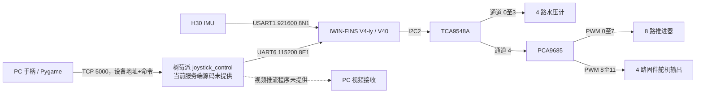
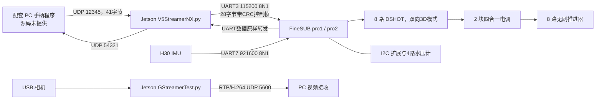

# 系统结构

本图按已读取的系统资料和固定源码整理。连接箭头说明数据/控制方向，不代替电气原理图。

## V4：树莓派 + C 板

PC 字节协议与固件命令表相对应，但 TCP 是字节流、固件依赖 UART 空闲中断分发；缺失的树莓派服务端如何处理边界和节拍尚无法核验。四路舵机是源码能力，不表示某台实物一定装有四只；采购表与旧接线说明存在数量差异。

## V4-pro：Jetson + A 板

Jetson 脚本和 FineSUB 的 28 字节控制帧在静态格式上相符；这不是实机链路通过的证明。FineSUB的推进器驱动使用DSHOT，舵机和灯具另用PWM；不能因为板卡端口名称含PWM就把电调协议当作普通脉宽控制。完整协议、原生字节序依赖和部署参数见 [Jetson 说明](../software/v4-pro-jetson/README.md)。

## 修改配置的位置

| 修改内容 | V4 | V4-pro |
| --- | --- | --- |
| 推进器顺序、方向、初始值、控制器 | `firmware/v4/userCode/devices/Src/Propeller.cpp` 与对应 `.h` | `firmware/v4-pro/Interface/Examples/TaskSUB.cpp`，另见 pro2 补丁 |
| 压力零偏、测点位置与深度处理 | `Sensor.cpp` / `Sensor.h` | `TaskSUB.cpp` 及 MS5837 驱动 |
| IMU 安装方向 | `IMU.cpp` 的 H30 映射 | pro1/pro2 的 `rotationOffset` |
| PC 地址、手柄映射 | `software/v4-topside/pc_client*.py` | Jetson 脚本固定 UDP / 串口参数；配套 PC 程序另行配套 |
| 舱内自启动 | 原机 systemd 服务未提供 | `software/v4-pro-jetson/deploy/` 示例模板 |

跨型号复用时应先明确命令含义、单位和坐标系，再验证硬件通道；文件名称里出现 V4、V5 或 SUB 不足以确定配套关系。
