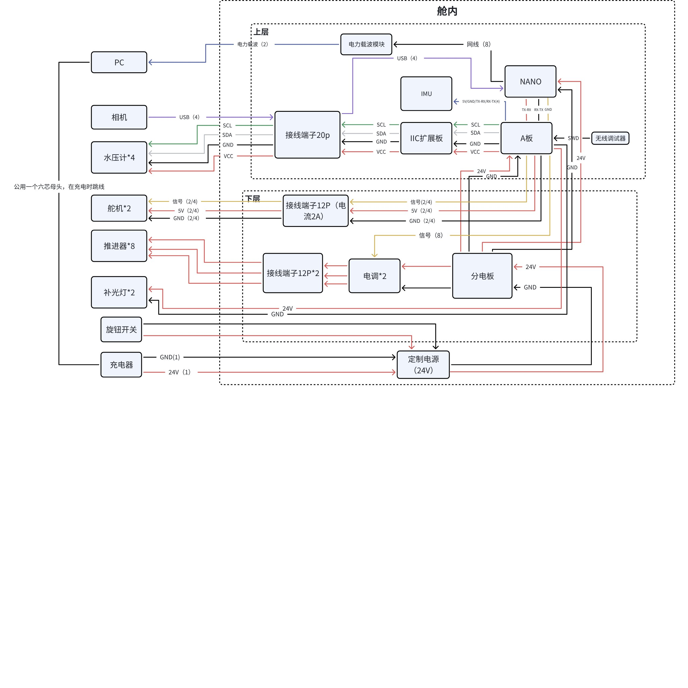

# V4-pro 硬件与制造

中文 | [English](hardware-v4-pro.en.md)

V4-pro 资料采用 **RM-A 主控、Jetson Orin 系列上位计算机、2 块四合一电调、8 个不带电调的推进器、4 个水压计、2 个舵机与 2 个补光灯**。本页依据《V4-PRO制作文档汇总（RM-A主控）》《V4接线简化图》和 Orin 配置说明整理。它与 [V4 的 RM-C / PCA9685 方案](hardware-v4.md) 使用不同的动力与控制链路。

## 模型与加工件

可查阅工程图位于 [V4-pro CAD](../hardware/v4-pro/cad)，完整 `V4pro.zip` 及原生 SolidWorks 文件保存在 [机械源文件 Release](https://github.com/FPJ-GAOGE/V4-Underwater-Robot/releases/tag/mechanical-source-2026-10-22)。[资源清单](../hardware/assets-manifest.json) 记录每个文件的来源和校验值。文件名含 `V4外形` 不改变其所属 `V4pro.zip` 的来源，不能因此归入 V4 旧版。

| 铝合金加工件 | 原制作文档数量 | CAD 入口 |
| --- | --- | --- |
| 侧支撑 | 2 | [STEP](../hardware/v4-pro/cad/主体/侧支撑.STEP)、[DWG](../hardware/v4-pro/cad/主体/侧支撑.DWG) |
| 底支撑（文件名“底支撑2”） | 2 | [STEP](../hardware/v4-pro/cad/主体/底支撑2.STEP)、[DWG](../hardware/v4-pro/cad/主体/底支撑2.DWG) |
| 上推进器支撑 | 2 | [STEP](../hardware/v4-pro/cad/主体/上推进器支撑.STEP)、[DWG](../hardware/v4-pro/cad/主体/上推进器支撑.DWG) |
| 前云台底座 | 1 | [前云台底架 STEP](../hardware/v4-pro/cad/相机云台/前云台底架.STEP)、[DWG](../hardware/v4-pro/cad/相机云台/前云台底架.DWG) |
| 后舱盖 | 1 | [后舱盖165 STEP](../hardware/v4-pro/cad/密封舱/后舱盖165.STEP)、[DWG](../hardware/v4-pro/cad/密封舱/后舱盖165.DWG) |

亚克力管、密封圈、法兰及固定件须按完整装配体选型。以上数量来自制作清单，不等于 CAD 中所有零件的完整采购展开表；图中未提供的材料牌号、公差、表面处理和密封等级应根据实际工程图及供应商要求补齐。

原文要求 3D 打印上层板架 1、下层板架 1、水压计固定件 4、补光灯固定件 2。对应 [舱内板架](../hardware/v4-pro/cad/密封舱/舱内)、[水压计固定](../hardware/v4-pro/cad/水深传感器) 和 [灯具固定](../hardware/v4-pro/cad/外设) 模型；热熔预埋螺母按模型区分 **M3 与 M4**。这与 V4 的 M2.5/M3 板架说明不同。

## 推进器与外部线束定制

| 设备 | 数量与规格 | 文档中的线长/插接要求 |
| --- | --- | --- |
| 推进器 | 8 个，不带电调；4 正桨、4 反桨 | 每一正一反为一组，4 组防水线分别为 **65、50、38、32 cm**；1W 3 芯插头，对应插座按文档定制 15A、20 cm 线 |
| 水压计 | 4 个，316L 不锈钢，所选传感器量程 10m | **70 cm** 防水线，00W 4 芯；针位 1 红、2 黑、3 绿 SCL、4 白 SDA；插座 20 cm 线 |
| 补光灯 | 2 个，PWM 控制，文档标光束角 100° | 1W 3 芯，60 cm 防水线；1 红、2 黑、3 黄 PWM；插座标 3A、20 cm 线 |
| 舵机 | 2 个 | 1W 3 芯，75 cm 防水线；1 红、2 黑、3 黄 PWM；插座标 2A、20 cm 线 |

上述插座电流标记是原加工要求，不是整机电流预算或已测得的持续能力。针位必须明确是插头还是插座、插合面还是焊接面，完成后一对一做通断核验。

**Pro 推进器的三根线是电调输出到无刷电机的三相线。** 原文说三相线无固定线序要求，但交换相线会影响旋向，因此仍需逐路验证桨型与旋转方向。它们不是 V4 原方案的正极、负极、PWM 三线；不能按红黑黄含义交叉替换两款潜器线束。

## 机械与舱内电气装配

1. 将推进器装到侧支撑和上推进器支撑，原文要求侧支撑使用平头螺丝；保持桨型、线长组与安装位置的标签对应。
2. 将插座安装到带螺纹的后舱盖。原方案不另用螺母；实际紧固方法按接插件与舱盖螺纹、密封件要求确定，不把“拧紧”视为可忽略扭矩和密封面的理由。
3. 安装水压计固定件及两侧补光灯，检查线束不干涉推进器、云台与舱体拆装。
4. 按 M3/M4 孔位将预埋螺母装入上下板架，试装 RM-A、Jetson、分电板、两块电调、I2C 扩展、IMU 与接线端子。
5. 制作电调动力线和电容连接、分电板支路、定制电池连接、旋钮开关及电力载波线束。原文有缩短电池接头的步骤；应以完成并核验的线束组件装配，不在带电状态改线。
6. 原文从 A 板 OLED 供电口改线给 I2C 扩展供电，同时明确水压计链路使用 3.3V。按具体 A 板引脚定义识别 3.3V 与 GND，不能只凭端口名称接电。
7. 裁剪插座舱内线，保留拆装余量；为相机制作相应穿舱件，整理并固定线束，再完成舱内总成试装。

## 原图与电压冲突

原接线图标出定制主电源 **24V**、舵机供电 **5V**，制作文档却要求把 A 板“可调 PWM 电压输出”调至 **8.4V**。图中的灯具动力线也标为 24V。这些信息不能合并成一条“所有 PWM 设备均使用 8.4V”或“全部使用 5V”的接线指令。

装配前先记录实际舵机、灯具、A 板、Jetson 载板和电调的供电规格，再分别测量主电源、执行器供电与逻辑电源。PWM 控制信号、板上可调负载电源、24V 动力轨是不同对象。未确认具体硬件前，不在本仓库指定一个统一的 5V/8.4V 结论。原图继续保留，并在此处明确冲突，便于与实机逐项校对。

图中还有 20P 信号端子、12P 舵机端子和 12P×2 电机端子，而采购文字仅列“12P×2”。因此端子总数、极数和电流能力应按最终线束表重新展开，不能把图与文字中的数量视为已一致。

## 主控、Jetson 与通信

| 链路 | 资料要求 | 核验点 |
| --- | --- | --- |
| Jetson → RM-A | 指定达妙载板的 `/dev/ttyTHS1` 接 RM-A **UART3** | 此设备名及物理位置只适用于文档所用载板，其他版本按载板手册核对 |
| 串口线 | GH1.25 4 pin 线去掉 **5V 供电线**，保留 GND↔GND、TX↔RX、RX↔TX | 不通过这条串口线给另一块板供电 |
| 相机 → Jetson | USB 连接，文档使用载板 USB-C 接口 | USB 接口类型和供电能力按所用载板确认 |
| PC → Jetson | 以太网；完整舱体使用成对电力载波模块 | 初次联调先用直接网线验证，再加入载波模块，分别排查链路 |
| IMU → RM-A | IMU 参数 **921600、400Hz** | 原制作文档要求供应商刷相应固件；烧录后检查实际输出，而不只看指示灯 |
| I2C 扩展 → 水压计 | 扩展板接 RM-A，使用 **3.3V**；四芯针位正、负、SCL、SDA | 核对地参考与每路通道号 |
| 调试器 → RM-A | SWD 无线烧写器 | 资料清单为 2 个，不代表同时连两个调试器到一块板 |

Orin 资料覆盖 Orin NX，并称 Orin Nano 同样适用；硬件载板说明针对达妙载板。不能把“NANO”进一步替换成任意 Jetson Nano 老型号，也不把源文档中的默认凭据、固定电脑路径或固定网络地址作为本仓库配置。

## 单设备调试与整机验证顺序

本仓库收录的FineSUB pro1/pro2源码以 **DSHOT** 驱动8路推进器，启用双向3D模式与遥测；舵机和灯具才使用PWM脉宽控制。原制作文字只给出板上信号接头字母，没有给出完整电调固件及协议配置。电调配置必须与固定固件匹配，不能把板卡PWM接头名称理解为推进器使用50 Hz模拟PWM。详见 [固件入口与协议](../firmware/v4-pro/IMPORT.md)。

1. **供电与主控**：在舱外使用受控恒压电源验证各电源轨，确认 RM-A 和 Jetson 启动、串口链路与下载接口正常；完成固件/上位程序版本记录。
2. **IMU 与压力**：设置 IMU 波特率和输出频率，读取并检查姿态、角速度；逐个接入四路压力，记录零偏与物理位置。传感器量程不能作为舱体耐压指标。
3. **电调与推进器**：完成四合一电调参数配置与 8 路信号连接。原制作文档把信号接口写为 `Z~S`，应按所用 A 板丝印及实际固件定时器通道逐个确认。文档的“左上 1 号、右上 8 号”不能替代完整编号表。
4. **灯具与舵机**：原文灯具接 A/B，舵机接 C/D。先解决上文 5V/8.4V 与动力轨冲突，再在舵机归零后装配相机角度，避免机构装配零位与控制零位不一致。
5. **上位链路**：先验证手柄指令能到达 RM-A，再验证视频与载波链路。使用自启服务前先手动运行并记录串口和网络配置，验证重启后恢复；不要把两份程序重复启动到同一个串口。
6. **整机姿态**：原制作文档将上方推进器描述为竖直组，下方为水平组，并提到 `V5_sub` 的推力矩阵。这个历史软件名称不改变机械型号为 V4-pro，也不是套用 V4-ly 矩阵的理由。先核对物理编号、旋向和固件输出映射，再评估是否需要改变矩阵。

## 封舱与水密

原制作流程为：组装亚克力管，把舱内电路装入但**取出电池**，下水观察漏水，确认后再装回电池。执行时保持电路断电，检查舱盖、穿舱连接器、相机穿线处、密封圈及灌封件；取出后检查并干燥，发现渗漏先修复再继续。随后进行岸上整机控制测试，最后进行受控下水测试。

本仓库收录的是制作资料与模型，没有完成新的实机、水密或耐压试验。原资料未提供统一的额定潜深、保压时间或验收压力；不把 24V 主电源、10m 传感器选项或材料名称推导为已验证的系统性能。
