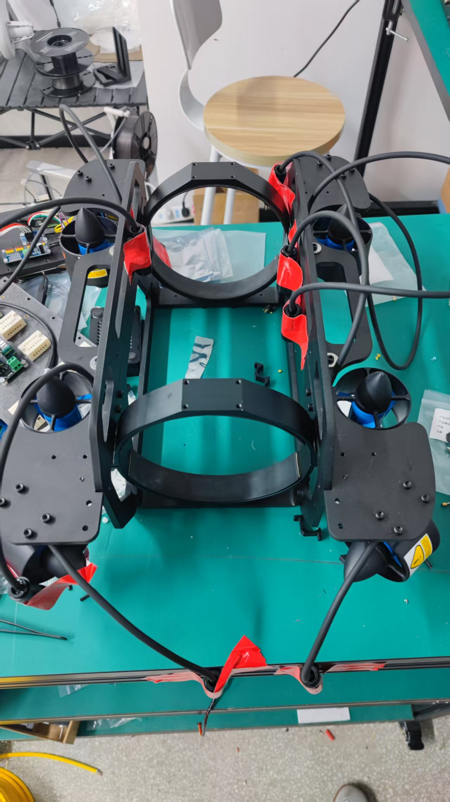
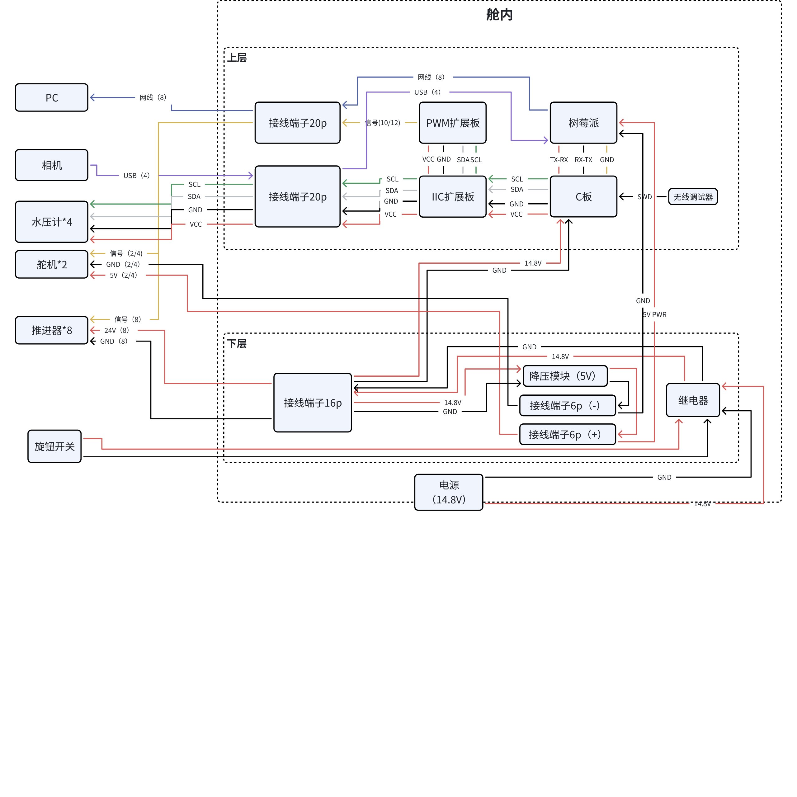
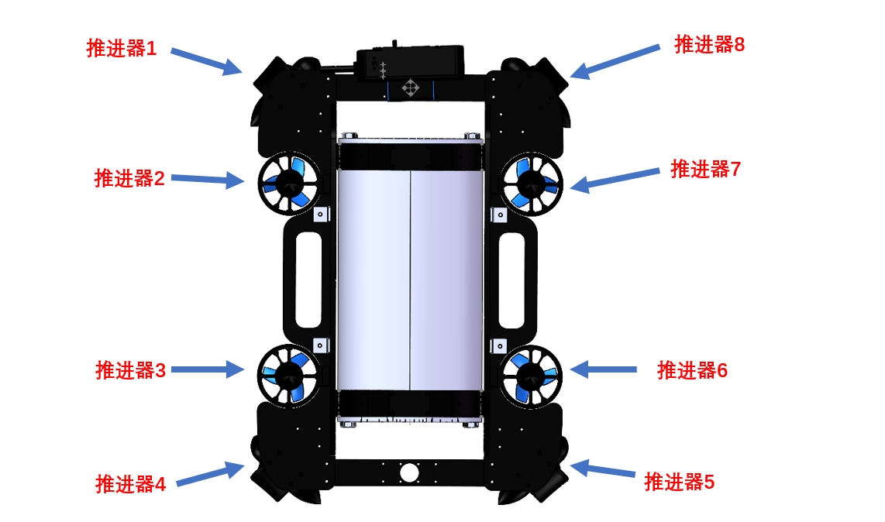
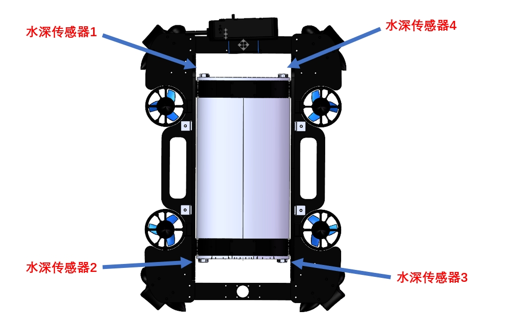

# V4 硬件与装配

中文 | [English](hardware-v4.en.md)

V4 的资料组合是 **RM-C 主控、树莓派 4B、PCA9685 PWM 扩展、8 个推进器与 4 个水压计**。本页根据《比赛细节与V4设计》《AUV电路连接设计及元件清单》及结构、配件表整理；固件行为以 [V4 控制固件说明](firmware-v4.md) 为准。V4-pro 的 RM-A、舱内四合一电调及 Jetson 接线见 [另一份硬件说明](hardware-v4-pro.md)。

## 选择机械版本

| 资料版本 | 含义 | 本仓库入口 |
| --- | --- | --- |
| 2025-05-23 完善设计 | 结构表中最新的完整 V4 模型，作为本次完整机械基准 | [V4 CAD](../hardware/v4/cad) |
| 2025-07-10 单目相机支架 | 后续单独支架包，不是一次完整整机更新 | [单目相机支架](../hardware/v4/camera-mount) |
| 机械爪结构附加包 | 独立保存的机构设计；原文仍有待完成事项，不声称已经与上述整机完全装配验证 | [机械爪模型](../hardware/v4/manipulator) |

结构表还记录了 2024-12-14 基础模型、2025-02-10 云台与外壳修改、2025-02-21 新框架、2025-02-25 按规则修改框架。复现时应选定一套完整版本，再明确加入哪些后续部件，避免凭同名 `V4.zip` 混用不同日期零件。

可直接查阅的 STEP / DWG 文件放在 CAD 目录；原始 SolidWorks 工程和附件压缩包保存在私有仓库的 [机械源文件 Release](https://github.com/FPJ-GAOGE/V4-Underwater-Robot/releases/tag/mechanical-source-2026-10-22)。[资源清单](../hardware/assets-manifest.json) 记录归档与文件校验值。原设计曾采用双目相机，后续另有单目支架，因此相机外形、孔位和供电也要与所选版本一起确认。

## 下单与加工准备

先按 [BOM](bom.md) 选择元件，再用所选完整装配体核对孔位、线缆出口、连接器外径和安装空间。源文档的加工流程是：上传铝合金零件 STEP，选择黑色阳极氧化、哑光；涉及螺纹孔的零件同时提交 DWG。材料牌号、尺寸公差及螺纹要求以对应工程图为准，原文没有提供的参数不能用外观图补齐。

打印件用于舱内板架、传感器固定和相机连接等结构，先核对所选 CAD 的孔位与板卡版本。资料没有统一给出打印材料、层高、填充率或承压验证，打印件的存在不代表它具有压力容器能力。相机支架的 2025-07-10 两份 SLDPRT 保持为独立更新。

线束定制应在框架与推进器试装后确定长度。V4 配件表允许把推进器和舵机寄给连接器商家加工；向商家提供设备型号、插头/插座配对、针位图、线长定义和端部余量，不能仅写“3 芯”。水压计使用外置套管延长，表中要求 **00W 4 芯插头与插座、4 芯电缆 65 cm**。这个长度不同于 Pro 的 70 cm。

## 框架、线缆与舱内装配

1. 按选定模型拼装铝合金框架并安装 8 个推进器，先检查相机云台运动范围和线缆走向，再确定每路线长。
2. 依据推进器、舵机实物线束功能制作水下连接器。V4 原方案的推进器三线是**电源正、电源负、控制信号**，原文记录红、黑、黄颜色对应。必须按实际连接器插合面针号复核，不能套用 Pro 的三相电机线接法。
3. 水压计通过“传感器—外置套管—水密连接器”延长；固定焊点后按连接器与灌封材料的工艺进行环氧灌封。原文没有给出树脂配比、固化时间或压力等级，应采用所购材料说明。
4. 将配对母座安装到后舱盖，检查密封件、线缆弯折半径及舱内可拆卸余量，随后安排接线端子位置。
5. 在打印板架的指定孔位安装热熔预埋螺母。原文：树莓派、PWM 扩展板使用 M2.5，其余相关位置使用 M3；不是每个孔都需要螺母。
6. 按板架安装尼龙柱；原文说明 C 板与接线端子不需要同样的支柱，树莓派/PWM 板为 M2.5，其他相关位置为 M3。不要把所有孔统一改为一种规格。
7. 分层固定板卡后，把端子排先取出接线，预留足够线长再装回。开关的控制线接继电器控制端，电源路径和弱电信号分开标识。
8. 接好线后先完成舱外可见状态的电气检查与单设备调试，再装入密封舱；避免封舱后才发现端子松脱或接口被遮挡。

## 电气连接

[原始电气连接 PDF](../hardware/v4/electrical-connection.original.pdf) 与下图保留供追溯。原资料和当前代码有不同阶段的配置，本页明确列出差异，不把历史图当作已经验证的最终接线表。

| 链路 | V4 资料描述 | 复现时核对 |
| --- | --- | --- |
| C 板 → I2C 扩展 | 原文 C 板 I2C 接口 2、4、6、8 分别对应 GND、VCC、SCL、SDA | 核对具体 C 板接口编号与板卡说明，VCC 不能与执行器电源混用 |
| I2C 扩展 → 水压计 | 输出 0–3；GND/VCC/SCL/SDA 对应黑/红/绿/白 | 同时核对每个水压计位置、连接器针位和固件索引 |
| I2C 扩展 → PCA9685 | 输出通道 4，按 GND/VCC/SCL/SDA 连接 | 当前固件也使用 TCA 通道 4 |
| PCA9685 逻辑/负载供电 | 原文 C 板 PWM 口 5V 接 PCA9685 的 V+，逻辑 VCC 走 I2C 侧 | V+ 与逻辑 VCC 作用不同；整机供电拓扑须与所购板型一致 |
| 推进器控制 | PCA9685 输出通道 0–7 的 PWM 接 8 路信号线 | 电机供电走动力路径，不通过 PWM 信号针 |
| 舵机控制 | 旧电路文档为通道 8–11，GND/V+/PWM 三线 | 配件表只列 2 个舵机，而旧文档与固件均保留 4 路，见下方冲突表 |
| 4S 电池 → 开关路径 | 电池、继电器/开关、分支供电、降压模块，C 板和推进器接动力路径 | 按实际电流、导线与保护器件定型，不以旧继电器名称替代整机核算 |
| 降压模块 → 树莓派/舵机 | 原文分支给树莓派和两个舵机；树莓派使用 5V 电源 | 舵机工作电压另按实物核对，不能把所有负载默认为同一电压 |
| SWD | SWCLK、SWDIO、GND、3.3V 对应连接调试器 | 确认目标板供电与调试器连接方式 |
| UART6 | TX↔RX、RX↔TX、GND↔GND | 当前 `V4-ly` 为 115200、8E1；旧文档其他串口速率不替代当前固件设置 |
| H30 IMU → USART1（源码补充） | 当前固件用H30姿态反馈，USART1配置921600、8N1 | 原采购表没有列出H30；按实际板卡确认TX/RX/GND及供电，不能直接照搬Pro的UART7；启动仍检查BMI088 |
| 树莓派通信 | 原方案有 GPIO UART 或 USB 转 TTL 两种接法 | 旧资料混用了物理针号与 GPIO 标号，不直接复刻其针号文字；按实际树莓派引脚图和已启用 UART 核对 |

电池线束按成品连接器和支路设计制作；旧文档将 XT60 称为“平衡头”的表述不准确，XT60 主电源接口与电池均衡接口不能混为一谈。本说明不照搬剪断电池引线的旧步骤。

## 推进器与水压计编号

原设计注明下列图均为**从上向下的俯视图**。装配时先固定机器人前向，再标记物理编号，并单独记录它与 PCA9685 通道、源码零基索引的对应关系。不能将图上的 1–8 直接当作固件数组的 0–7。

当前固件内侧推进器数组为 `{1,2,6,5}`，外侧为 `{0,3,7,4}`；它们、正反桨符号和推力分配矩阵要成组核对。物理排列确认后再验证每一个正向输入的实际作用，不通过随意改某一项负号掩盖编号错误。

## 不能自动消解的资料差异

| 项目 | 不同证据 | 本仓库处理 |
| --- | --- | --- |
| 舵机数量 | 配件表为 2；旧电路清单和通道说明为 4；固件 `SERVO_NUM=4` | 保留两种数量来源，按当前相机/机构版本选择实装数量并检查未接通道 |
| 继电器 | 配件表为“30A继电器”；旧电路文档为“120A继电器” | 不直接取较大或较小值，要求按实物型号与动力支路设计核对 |
| 接线端子 | 配件表为 20P/16P/6P 等具体型号；旧电路正文描述多组 6 针与 7 针座 | 两者为不同布局阶段，按 CAD、孔位与当前线束配套，不能累计下单 |
| 相机 | 完整设计含双目方案；后续有 2025-07-10 单目支架包 | 完整模型日期与支架更新日期分开记录 |
| PWM 静止值 | 旧协议写 1500 μs；当前固件为 1590 μs | 依据所用固件和实际电调标定，不把旧数字作为已验证的停止值 |
| 主控命名 | 系统资料称 RM-C；源工程目标为 STM32F407IGHx | 两项事实分别保留；不能据名称推断所有 RM-C 板型直接兼容 |

## 通电、封舱与水密验证

先保持舱体可打开，逐项测量各电源轨与极性，核对断电状态下的线束通断和对地短路，再用受控电源分支调试。依次验证主控、上位计算机、串口、IMU、四路水压反馈，随后确认单路推进器与机构方向、控制关闭后的实际输出及供电切断方式。软件“关闭闭环”不等同于切断推进器电源。

确认连接器灌封完全固化、舱盖密封面和密封圈状态后，先在**去除电池并保持断电**的状态进行观察性漏水检查；取出后检查舱内和每个穿舱位置，干燥并排除渗漏后再进入后续通电试验。这一流程是整理建议，不代表已做过本机的水密试验。原资料未给出系统额定潜深、压力保压时间或合格判据，传感器“10m”量程也不能转换为整机额定潜深。

最后记录装配版本、实物针位、电源轨实测值、线长、推进器与压力通道映射、固件提交和测试结果，使后续维护能对应到这台具体 V4。
